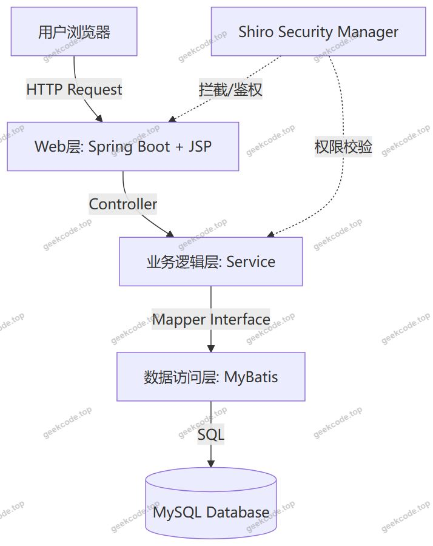
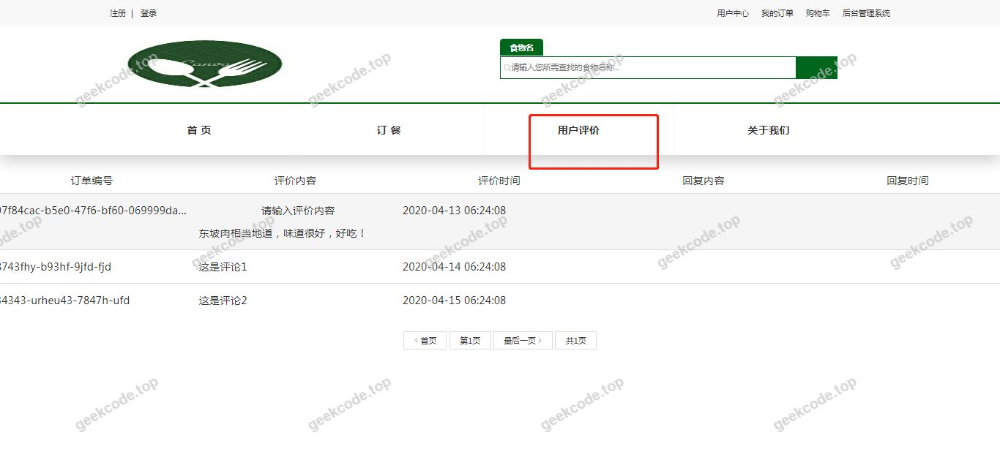
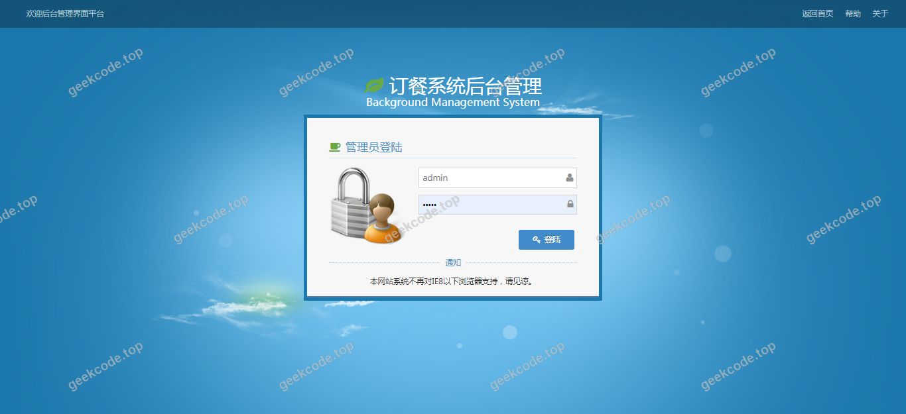
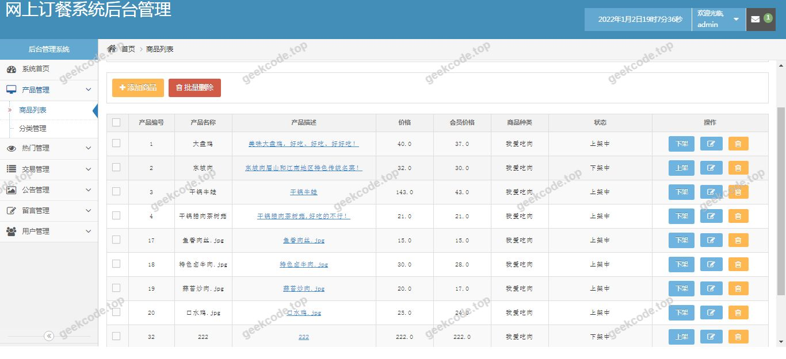
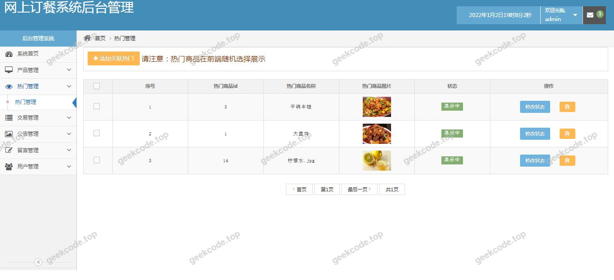
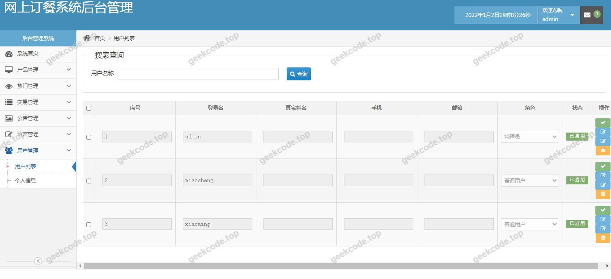

# java精品项目-基于springboot实现简单点餐系统

> 🎓 **计算机毕业设计 · java精品项目-基于springboot实现简单点餐系统**
>
> 本仓库只放**项目介绍 + 运行截图**（截图是站点带水印的原图，存在仓库 `images/` 里）。
>
> 👉 **完整可运行源码 / 数据库脚本 / 部署文档：[点我获取](https://geekcode.top/archives/java%E7%B2%BE%E5%93%81%E9%A1%B9%E7%9B%AE-%E5%9F%BA%E4%BA%8Espringboot%E5%AE%9E%E7%8E%B0%E7%AE%80%E5%8D%95%E7%82%B9%E9%A4%90%E7%B3%BB%E7%BB%9F?utm_source=github)**
>
> 💬 咨询微信：**ir9372**　|　🌐 更多项目：[极客代码 geekcode.top](https://geekcode.top/?utm_source=github)
>
> 📌 项目详情页：<https://geekcode.top/archives/java%E7%B2%BE%E5%93%81%E9%A1%B9%E7%9B%AE-%E5%9F%BA%E4%BA%8Espringboot%E5%AE%9E%E7%8E%B0%E7%AE%80%E5%8D%95%E7%82%B9%E9%A4%90%E7%B3%BB%E7%BB%9F?utm_source=github>

<table><td width="230" align="center"> <b>扫码加微信 ir9372</b></td><td valign="middle">📦 源码 = 项目介绍 + 全部运行截图 + 数据库 + 部署文档 👉 点上方任意截图，直接跳到 <b>极客代码 geekcode.top</b> 详情页</td></table>

---

<h1>java精品项目-基于springboot实现简单点餐系统</h1>
<h2>项目概述</h2>

本项目名为“java精品项目-基于springboot实现简单点餐系统”，旨在构建一个轻量级的在线点餐服务平台。该系统主要面向餐饮商家及消费者，提供基础的菜品浏览与下单功能，简化传统线下点餐流程，提升服务效率。项目采用后端渲染模式，通过 Spring Boot 框架整合 MyBatis 进行数据持久化操作，并引入 Shiro 框架保障系统安全。虽然项目元数据显示无独立的前台导航菜单与后台路由配置，但根据截图所示的九个运行界面，系统具备完整的用户交互视图，涵盖从首页展示到订单处理的核心业务流程。适用人群包括小型餐饮店主、食堂管理者以及需要快速搭建原型系统的开发者。技术架构上，项目摒弃了复杂的前后端分离部署，采用 JSP 结合 Tomcat 嵌入式容器的方式，实现了逻辑与视图的快速迭代，适合毕业设计或小型演示场景。

<h2>技术架构</h2>

本系统采用经典的 MVC（模型-视图-控制器）设计模式，整体架构分为表现层、业务逻辑层和数据访问层。

<strong>核心技术选型：</strong>

<ol>
<li><strong>Spring Boot (spring-boot-starter-web)</strong>：作为核心框架，负责自动配置、依赖管理及内嵌 Tomcat 服务器的启动，极大简化了 Java Web 应用的搭建过程。</li>
<li><strong>MyBatis (mybatis-spring-boot-starter)</strong>：用于数据库交互，通过 XML 映射文件或注解方式定义 SQL 语句，实现对象关系映射（ORM），保证了对 MySQL 数据库的高效访问。</li>
<li><strong>Apache Shiro (shiro-spring)</strong>：提供身份认证和授权管理，确保只有合法用户才能访问特定资源，增强了系统的安全性。</li>
<li><strong>JSP &amp; JSTL (javax.servlet-api, jstl)</strong>：作为视图层技术，配合 <code>tomcat-embed-jasper</code> 支持动态网页渲染，直接在后端生成 HTML 页面返回给浏览器。</li>
</ol>

<strong>架构特点：</strong>

<ul>
<li><strong>单体架构</strong>：所有功能模块集中在一个应用中，便于开发和维护。</li>
<li><strong>后端渲染</strong>：前端页面由服务器端 JSP 引擎生成，而非通过 JavaScript 动态加载，减少了客户端计算压力。</li>
<li><strong>数据流向</strong>：用户请求 -&gt; DispatcherServlet -&gt; Controller -&gt; Service -&gt; Mapper -&gt; Database，响应结果逆向返回并渲染至 JSP 页面。</li>
</ul>

<h2>功能模块</h2>

根据提供的截图列表（系统运行界面1至9）及技术栈信息，系统主要包含以下功能模块。由于项目元数据标记“是否有前台: 否”、“是否有后台: 否”，此处将功能统一归纳为系统交互界面所呈现的业务能力，不强行区分前后台物理隔离，而是按业务逻辑划分。

<h3>1. 基础展示与导航模块</h3>
<ul>
<li><strong>首页概览</strong>：展示系统主入口，可能包含推荐菜品、公告或登录入口（对应部分运行界面）。</li>
<li><strong>菜品列表页</strong>：以网格或列表形式展示所有可点选的菜品，包含图片、名称、价格等基本信息。</li>
</ul>
<h3>2. 核心业务模块</h3>
<ul>
<li><strong>菜品详情查看</strong>：点击具体菜品后，显示详细描述、规格选项及大图预览。</li>
<li><strong>购物车/订单暂存</strong>：允许用户选择菜品数量，临时存储待结算的订单信息。</li>
<li><strong>订单提交与确认</strong>：用户确认所选菜品后，生成正式订单，记录下单时间、总金额等信息。</li>
</ul>
<h3>3. 安全与管理模块</h3>
<ul>
<li><strong>用户认证</strong>：基于 Shiro 实现的用户登录、登出功能，验证用户身份合法性。</li>
<li><strong>权限控制</strong>：根据用户角色限制对某些敏感操作（如查看历史订单、修改个人信息）的访问权限。</li>
</ul>

<em>(注：因未提供具体代码逻辑细节，以上模块基于“简单点餐系统”通用功能及9张运行界面截图推断，仅涵盖可见的交互层面，未涉及复杂的后台数据统计报表功能)</em>

<h2>用户角色与权限</h2>

基于 Apache Shiro 的安全机制，系统设计了基本的角色权限体系。尽管项目未明确列出多角色后台管理界面，但 Shiro 的存在表明系统至少区分了“游客”与“注册用户”两类主体，或存在隐含的管理员角色用于数据维护。

<h3>1. 游客 (Guest)</h3>
<ul>
<li><strong>访问范围</strong>：仅限公共浏览区域。</li>
<li><strong>权限描述</strong>：</li>
<li>可以查看首页及菜品列表。</li>
<li>可以查看菜品详细信息。</li>
<li><strong>不可</strong>进行下单、加入购物车或查看个人历史记录。</li>
<li>需跳转至登录页面才能进行后续操作。</li>
</ul>
<h3>2. 普通用户 (User)</h3>
<ul>
<li><strong>访问范围</strong>：个人中心及交易相关功能。</li>
<li><strong>权限描述</strong>：</li>
<li><strong>登录/注册</strong>：拥有账户创建和身份验证权限。</li>
<li><strong>点餐操作</strong>：可将菜品加入购物车，执行删除、修改数量等操作。</li>
<li><strong>订单管理</strong>：提交新订单，查看自己的历史订单状态。</li>
<li><strong>个人信息</strong>：修改密码或基本资料（视具体实现而定）。</li>
</ul>
<h3>3. 管理员 (Admin) - <em>推测性角色</em></h3>
<ul>
<li><strong>说明</strong>：虽然元数据标注“是否有后台: 否”，但通常此类毕设项目若使用 Shiro，往往预留了超级管理员权限用于初始数据导入或紧急干预。若无专门后台界面，此角色可能仅存在于数据库权限表中，或通过直接访问特定 URL 触发。</li>
<li><strong>权限描述</strong>：</li>
<li>理论上拥有所有用户的最高权限。</li>
<li>可能具备查看所有订单、下架违规菜品等隐性管理能力（具体取决于代码中是否硬编码了 Admin 路径，鉴于信息不足，此处仅做理论陈述）。</li>
</ul>
<h2>项目特色与创新点</h2>
<ol>
<li>
<strong>轻量化架构设计</strong>：
   项目采用了 Spring Boot 结合 JSP 的传统混合模式，避免了现代前后端分离架构中复杂的 API 接口定义和前端工程化配置。这种设计使得项目在开发阶段能够专注于业务逻辑的实现，降低了学习曲线，非常适合计算机专业本科毕业设计中对“全栈”概念的理解与实践。

</li>
<li>
<strong>安全性集成</strong>：
   引入 Apache Shiro 框架是本项目的一大亮点。相比于简单的 Session 判断，Shiro 提供了更细粒度的权限控制（RBAC 模型雏形）。它能够有效防止未授权访问，保护用户隐私数据（如订单信息）不被非法获取，体现了对 Web 应用安全性的重视。

</li>
<li>
<strong>直观的后端渲染体验</strong>：
   利用 <code>tomcat-embed-jasper</code> 和 JSTL 标签库，实现了服务端动态内容生成。这种方式 SEO 友好（虽非重点），且首屏加载速度快，无需等待大量 JS 脚本执行，为用户提供了流畅的点餐浏览体验。

</li>
<li>
<strong>模块化数据持久层</strong>：
   通过 MyBatis 与 Spring Boot 的深度整合，实现了 SQL 语句与 Java 代码的解耦。这使得数据库查询优化变得容易，同时也便于在后期扩展更多复杂的统计查询需求，具备良好的可维护性。

</li>
</ol>
<h2>部署环境</h2>

为确保“java精品项目-基于springboot实现简单点餐系统”正常运行，需准备以下软硬件环境：

<h3>1. 硬件要求</h3>
<ul>
<li><strong>处理器</strong>：Intel Core i5 及以上或同等性能 CPU。</li>
<li><strong>内存</strong>：建议 8GB RAM 以上，以保证 JVM 运行流畅及数据库缓存效率。</li>
<li><strong>磁盘空间</strong>：至少预留 10GB 可用空间，用于存放操作系统、JDK、Maven 仓库、MySQL 数据文件及项目源码。</li>
</ul>
<h3>2. 软件环境</h3>
<ul>
<li><strong>Java 开发工具包 (JDK)</strong>：</li>
<li>版本：JDK 1.8 或 JDK 11（推荐 LTS 版本）。</li>
<li>配置：需正确设置 <code>JAVA_HOME</code> 环境变量。</li>
<li><strong>构建工具</strong>：</li>
<li>Maven 3.6+：用于下载依赖包（如 spring-boot-starter-web, shiro-spring 等）及打包项目。</li>
<li><strong>数据库管理系统</strong>：</li>
<li>MySQL 5.7 或 MySQL 8.0。</li>
<li>需安装 JDBC 驱动 (<code>mysql-connector-java</code>)，并在 <code>application.properties</code> 中配置正确的数据库连接 URL、用户名和密码。</li>
<li><strong>Web 容器</strong>：</li>
<li>内置于 Spring Boot 的 Tomcat (由 <code>spring-boot-starter-tomcat</code> 提供)，无需单独安装外部 Tomcat 服务器。</li>
<li><strong>开发 IDE</strong>：</li>
<li>IntelliJ IDEA 或 Eclipse。</li>
<li>需安装 Lombok 插件（如果代码中使用）及 Maven 插件。</li>
<li><strong>浏览器</strong>：</li>
<li>Chrome, Firefox 或 Edge 的最新稳定版，用于访问 JSP 渲染的前端页面。</li>
</ul>
<h3>3. 启动步骤简述</h3>
<ol>
<li>初始化 MySQL 数据库，执行建表脚本（若有）。</li>
<li>在项目根目录执行 <code>mvn clean install</code> 下载依赖并编译。</li>
<li>运行主启动类（带有 <code>@SpringBootApplication</code> 注解的 Java 文件）。</li>
<li>访问默认端口（通常为 8080）即可查看系统运行界面。</li>
</ol>
<h2>五、技术特性</h2>
<ul>
<li>服务端模板渲染（JSP）</li>
<li>集成 Shiro 权限框架实现角色权限控制</li>
</ul>
<h2>六、功能模块截图</h2>
<h3>前台用户端</h3>
<h4>系统运行界面1</h4>

<h4>系统运行界面2</h4>

<h4>系统运行界面3</h4>

<h4>系统运行界面4</h4>

<h4>系统运行界面5</h4>

<h4>系统运行界面6</h4>

<h4>系统运行界面7</h4>

<h4>系统运行界面8</h4>

<h4>系统运行界面9</h4>

---

## 获取完整源码

| 项目 | 说明 |
| --- | --- |
| 项目名 | java精品项目-基于springboot实现简单点餐系统 |
| 运行截图 | 本文 10 张（站点带水印原图，仓库 `images/` 目录） |
| 完整源码 | [https://geekcode.top/archives/java%E7%B2%BE%E5%93%81%E9%A1%B9%E7%9B%AE-%E5%9F%BA%E4%BA%8Espringboot%E5%AE%9E%E7%8E%B0%E7%AE%80%E5%8D%95%E7%82%B9%E9%A4%90%E7%B3%BB%E7%BB%9F?utm_source=github](https://geekcode.top/archives/java%E7%B2%BE%E5%93%81%E9%A1%B9%E7%9B%AE-%E5%9F%BA%E4%BA%8Espringboot%E5%AE%9E%E7%8E%B0%E7%AE%80%E5%8D%95%E7%82%B9%E9%A4%90%E7%B3%BB%E7%BB%9F?utm_source=github) |
| 咨询微信 | **ir9372**（备注：jingpin-yuanma） |
| 更多项目 | [极客代码 geekcode.top](https://geekcode.top/?utm_source=github) |

> 需要源码、部署、改配置、跑不起来等问题，加微信 ir9372 沟通，说明项目名即可。
